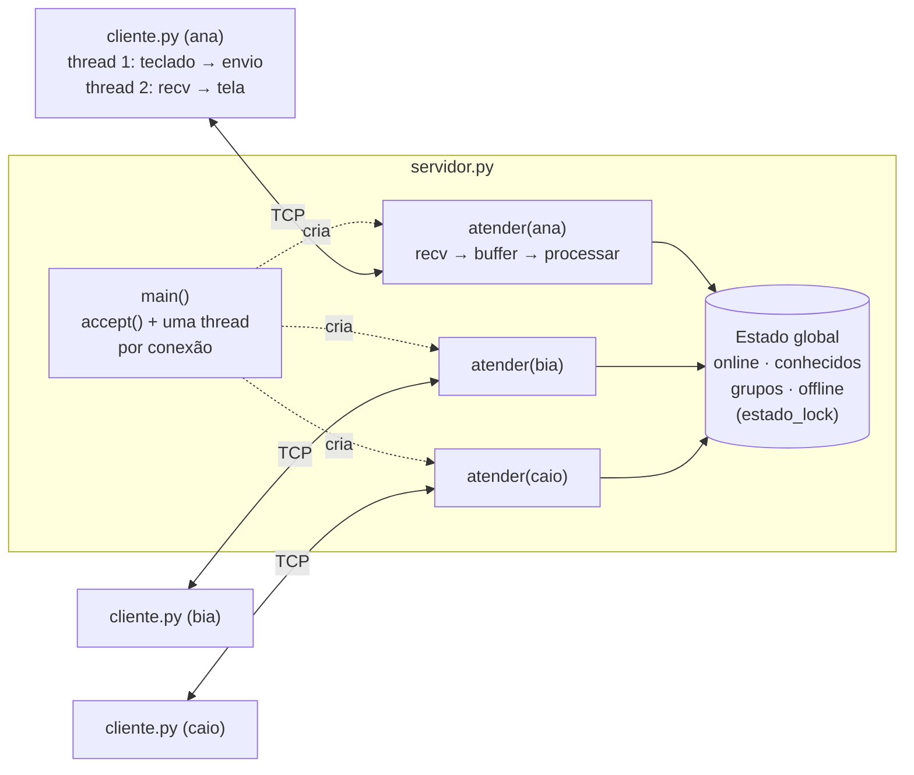
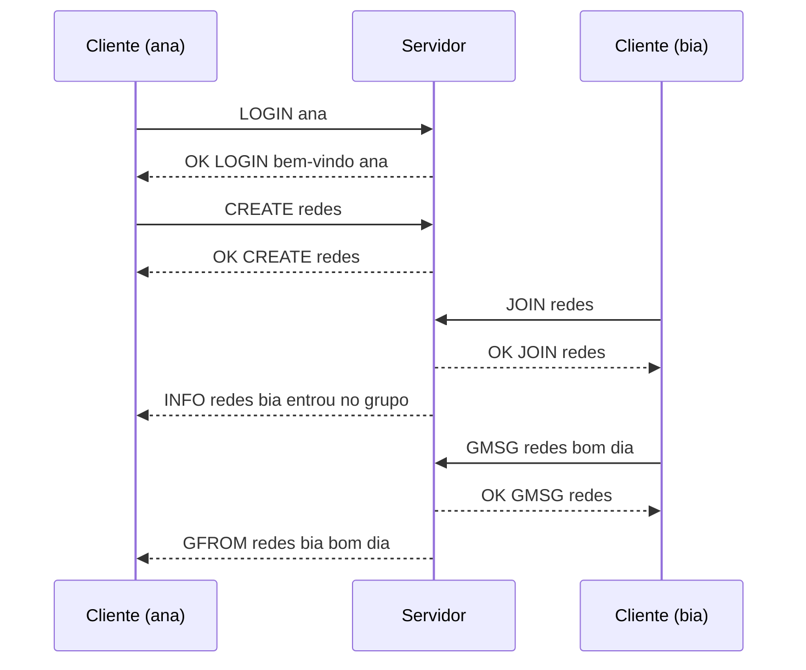

# Chat com Sockets TCP em Python

Serviço de troca de mensagens em tempo real, com mensagens particulares, grupos com administrador, entrega offline e notificações. Foi construído do zero sobre a API de sockets nativa do Python, com um protocolo de aplicação próprio (**CHAT/1**), um servidor concorrente com uma thread por cliente e nenhuma dependência externa.


> Projeto acadêmico da disciplina de Redes de Computadores. O objetivo era trabalhar diretamente com sockets, sem frameworks que abstraiam a comunicação, cobrindo definição de protocolo, gerenciamento de conexões, concorrência e tratamento de falhas.

---

## Sumário

- [Funcionalidades](#funcionalidades)
- [Demonstração](#demonstração)
- [Arquitetura](#arquitetura)
- [Decisões de projeto](#decisões-de-projeto)
- [O protocolo CHAT/1](#o-protocolo-chat1)
- [Tratamento de erros e falhas](#tratamento-de-erros-e-falhas)
- [Como executar](#como-executar)
- [Testes](#testes)
- [Estrutura do projeto](#estrutura-do-projeto)
- [Limitações e próximos passos](#limitações-e-próximos-passos)

---

## Funcionalidades

| Funcionalidade | Como funciona |
| --- | --- |
| **Identificação** | Cada usuário entra com um nick único (1 a 20 caracteres: letras, números e `_`). Nick repetido ou inválido é recusado. |
| **Mensagens particulares** | Entregues na hora se o destinatário está online. |
| **Mensagens offline** | Se o destinatário já usou o sistema mas está desconectado, a mensagem fica guardada e é entregue no próximo login. |
| **Grupos** | Criar, entrar, sair, enviar mensagem para todos os membros e listar membros. |
| **Administração de grupo** | Quem cria o grupo é o administrador e pode remover membros. Se o administrador sai, o cargo passa automaticamente para outro membro. Grupos vazios são apagados. |
| **Notificações** | Os membros são avisados quando alguém entra, sai, é removido ou cai, e quando o administrador muda. |
| **Consultas** | Listar usuários online, grupos existentes e membros de um grupo. |
| **Detecção de queda** | Uma desconexão abrupta (terminal fechado, rede caiu) é detectada e o estado é limpo automaticamente. |

---

## Demonstração

Sessão real com três clientes (`ana`, `bia` e `caio`) conectados ao mesmo servidor. Cada linha mostra, entre colchetes, o terminal em que ela aparece; `>` é o que o usuário digitou.

```text
[ana]  > /msg bia oi, tudo bem?
[ana]  << OK MSG entregue
[bia]  [privado] ana: oi, tudo bem?

[ana]  > /create redes
[ana]  << OK CREATE redes
[bia]  > /join redes
[ana]  * [redes] bia entrou no grupo
[caio] > /join redes
[ana]  * [redes] caio entrou no grupo
[bia]  * [redes] caio entrou no grupo

[bia]  > /gmsg redes bom dia, pessoal
[ana]  [redes] bia: bom dia, pessoal
[caio] [redes] bia: bom dia, pessoal

[bia]  > /kick redes caio
[bia]  !! ERR 403 apenas o administrador pode remover membros
[caio] > /raw FOO
[caio] !! ERR 400 comando desconhecido: FOO

[bia]  (fecha o terminal sem /quit)
[ana]  * [redes] bia desconectou
[caio] * [redes] bia desconectou

[caio] > /msg bia volta logo
[caio] << OK MSG armazenada (usuario offline)
[bia]  > /login bia
[bia]  << OK LOGIN bem-vindo bia
[bia]  [privado] caio: volta logo
```

Log do servidor durante a mesma sessão:

```text
[13:04:08] Servidor ouvindo em 0.0.0.0:39700
[13:04:09] Nova conexao de ('127.0.0.1', 47122)
[13:04:09] ('127.0.0.1', 47122) autenticado como ana (0 msgs offline)
...
[13:04:29] ('127.0.0.1', 47132) (bia) desconectado
[13:04:31] Nova conexao de ('127.0.0.1', 50876)
[13:04:31] ('127.0.0.1', 50876) autenticado como bia (1 msgs offline)
```

---

## Arquitetura

O sistema segue o modelo **cliente-servidor**. Os clientes nunca se comunicam diretamente: toda mensagem passa pelo servidor, que mantém o estado da aplicação.



### Ciclo de vida de uma requisição no servidor

1. **`main()`** aceita a conexão com `accept()`, cria um objeto `Cliente` (socket, endereço, nick) e inicia uma thread com `atender()`.
2. **`atender()`** lê os bytes com `recv()`, acumula num buffer e extrai cada linha completa terminada em `\n`.
3. **`processar()`** identifica o comando, verifica se o usuário fez login e separa os argumentos usando uma tabela de despacho (`COMANDOS`).
4. A função do comando (`cmd_login`, `cmd_msg`, `cmd_gmsg`, ...) valida as regras, altera o estado sob o lock e devolve `OK` ou `ERR`.
5. Ao sair, seja por `QUIT`, por fechamento ou por queda, o bloco `finally` chama **`desconectar()`**, que remove o usuário de `online` e de todos os grupos.

### Estado mantido pelo servidor

| Estrutura | Tipo | Conteúdo |
| --- | --- | --- |
| `online` | `dict` | nick → conexão de quem está conectado agora |
| `conhecidos` | `set` | todos os nicks que já fizeram login; distingue "offline" de "inexistente" |
| `grupos` | `dict` | nome → `{"admin": nick, "membros": set}` |
| `offline` | `dict` | nick → lista de mensagens aguardando entrega |

---

## Decisões de projeto

### Por que cliente-servidor e não P2P

O sistema precisa de um **estado compartilhado único**: quem está online, quais grupos existem, quem pertence a cada um e quais mensagens aguardam entrega. Num servidor central esse estado fica num só lugar, e nenhum participante tem uma visão divergente. Em P2P cada par precisaria manter e sincronizar uma cópia, e as mensagens offline não teriam onde ficar enquanto o destinatário estivesse desligado.

### Por que TCP e não UDP

Num chat, nenhuma mensagem pode se perder, chegar duplicada ou fora de ordem. O TCP garante entrega confiável e ordenada; com UDP seria preciso implementar confirmação, retransmissão e ordenação na aplicação. A latência um pouco maior não pesa para mensagens de texto. O TCP também sinaliza o fim da conexão (`recv()` retorna 0 bytes ou lança exceção), o que é usado para detectar desconexões.

### Delimitação de mensagens sobre um fluxo de bytes

O TCP entrega um **fluxo contínuo de bytes, sem fronteiras de mensagem**: um único `recv()` pode trazer meia mensagem ou várias de uma vez. Por isso cada mensagem do protocolo termina em `\n`, e o receptor acumula os bytes num buffer até encontrar o delimitador:

```python
buffer += dados
while b"\n" in buffer:
    bruto, buffer = buffer.split(b"\n", 1)   # uma mensagem completa
    ...                                       # o resto aguarda o próximo recv()
```

A decodificação UTF-8 só acontece depois que a linha está completa, então um caractere multibyte nunca é cortado ao meio. O buffer também tem um limite de 2048 bytes: uma linha maior é descartada com `ERR 413`, o que impede um cliente de esgotar a memória do servidor enviando dados sem nunca mandar o `\n`.

### Concorrência

- **Servidor:** uma thread por cliente. A thread principal fica livre no `accept()`, e um cliente inativo nunca bloqueia os outros.
- **`estado_lock`:** um único `threading.Lock` protege as quatro estruturas de estado, evitando condições de corrida. Por exemplo, dois `LOGIN ana` simultâneos nunca registram o mesmo nick duas vezes.
- **`lock_envio`:** um lock por cliente serializa as escritas no socket dele. Várias threads podem enviar para o mesmo usuário ao mesmo tempo sem que os bytes de duas mensagens se misturem.
- **Cliente:** duas threads. Uma fica no `input()` lendo o teclado; a outra fica no `recv()`, exibindo as mensagens assim que chegam. Dois `threading.Event` coordenam o encerramento.

O modelo de uma thread por cliente foi escolhido pela clareza do código. Para milhares de conexões simultâneas, a alternativa seria a multiplexação com `selectors` ou `asyncio`.

---

## O protocolo CHAT/1

Protocolo de texto, linha a linha, em UTF-8. A especificação completa, com todos os atributos, a sequência de interações e as regras de estado, está em **[`PROTOCOLO.md`](PROTOCOLO.md)**.

```text
COMANDO arg1 arg2 texto livre até o fim da linha\n
```

### Requisições (cliente → servidor)

| Comando | Descrição |
| --- | --- |
| `LOGIN <nick>` | identifica o usuário na conexão |
| `MSG <nick> <texto>` | mensagem particular |
| `CREATE <grupo>` | cria um grupo; o criador vira administrador |
| `JOIN <grupo>` / `LEAVE <grupo>` | entra ou sai de um grupo |
| `GMSG <grupo> <texto>` | mensagem para todos os membros |
| `KICK <grupo> <nick>` | remove um membro (só o administrador) |
| `USERS` / `GROUPS` / `MEMBERS <grupo>` | consultas |
| `PING` / `QUIT` | testa a conexão / encerra a sessão |

### Respostas e notificações (servidor → cliente)

Toda requisição recebe **exatamente uma** resposta, `OK <COMANDO> ...` ou `ERR <código> <descrição>`. Além disso, o servidor envia notificações assíncronas a qualquer momento:

| Notificação | Quando |
| --- | --- |
| `FROM <remetente> <texto>` | alguém enviou uma mensagem particular |
| `GFROM <grupo> <remetente> <texto>` | alguém enviou uma mensagem a um grupo seu |
| `INFO <grupo> <texto>` | entrada, saída, queda ou remoção de membro; troca de administrador |

### Exemplo de interação



### Códigos de erro

| Código | Significado | Exemplo |
| --- | --- | --- |
| `400` | requisição malformada | comando desconhecido, argumento faltando, bytes que não são UTF-8 |
| `401` | não autenticado | qualquer comando antes do `LOGIN` |
| `403` | proibido | `KICK` sem ser administrador, `GMSG` num grupo de que não é membro |
| `404` | não encontrado | usuário que nunca entrou, grupo inexistente |
| `409` | conflito | nick em uso, grupo já existente |
| `413` | mensagem muito longa | linha com mais de 2048 bytes |
| `422` | nome inválido | nick ou grupo com caracteres não permitidos |

---

## Tratamento de erros e falhas

| Situação | Comportamento |
| --- | --- |
| Comando inválido ou malformado | responde `ERR` com o código adequado; a conexão continua aberta e o estado não muda |
| Mensagens grudadas ou fragmentadas | o buffer remonta cada linha corretamente |
| Linha maior que 2048 bytes | `ERR 413` uma única vez; o restante é descartado até o próximo `\n` |
| Bytes que não são UTF-8 | `ERR 400`; a linha é descartada |
| Cliente fecha a conexão | `recv()` retorna 0 bytes e a limpeza é feita no `finally` |
| Queda abrupta (`ConnectionResetError`) | exceção capturada; mesma limpeza do encerramento normal |
| Falha ao enviar para um cliente | o envio retorna `False` sem derrubar o servidor; mensagens particulares viram offline |
| Administrador desconecta | o membro de menor nick em ordem alfabética assume, e todos são notificados |
| Servidor cai (lado do cliente) | o cliente avisa o usuário e encerra |
| Reinício rápido do servidor | `SO_REUSEADDR` evita o erro "Address already in use" |

A falha de um cliente afeta apenas a thread dele; o servidor e os demais usuários seguem funcionando.

---

## Como executar

### Requisitos

- **Python 3.10 ou superior**
- Nenhuma dependência externa. São usados apenas módulos da biblioteca padrão: `socket`, `threading`, `re`, `sys` e, nos testes, `subprocess`, `time` e `os`.

### 1. Iniciar o servidor

```bash
python servidor.py            # porta padrão 38912
python servidor.py 5000       # porta personalizada
```

### 2. Conectar clientes

Em outros terminais, abra quantos clientes quiser:

```bash
python cliente.py                        # conecta em 127.0.0.1:38912
python cliente.py 192.168.0.10 38912     # conecta a um servidor em outra máquina
```

O servidor escuta em todas as interfaces (`0.0.0.0`), então clientes de outros computadores da mesma rede podem conectar usando o IP da máquina do servidor. Pode ser necessário liberar a porta no firewall.

### Comandos do cliente

| Comando | Ação |
| --- | --- |
| `/login <nick>` | entrar no sistema |
| `/msg <nick> <texto>` | mensagem particular |
| `/create <grupo>` | criar grupo (você vira administrador) |
| `/join <grupo>` · `/leave <grupo>` | entrar ou sair de um grupo |
| `/gmsg <grupo> <texto>` | mensagem para o grupo |
| `/kick <grupo> <nick>` | remover membro (só administrador) |
| `/users` · `/groups` · `/members <grupo>` | listar usuários, grupos ou membros |
| `/raw <linha>` | envia a linha crua do protocolo, sem tradução (útil para testar erros) |
| `/help` · `/quit` | ajuda · sair |

---

## Testes

### Teste automatizado

```bash
python teste_automatico.py
```

O script sobe o servidor numa porta de teste, conecta três clientes simultâneos e faz **36 verificações** das respostas do protocolo:

```text
1. Login e erros de login
  ok     esperado 'ERR 401...'  recebido 'ERR 401 faca LOGIN primeiro'
  ok     esperado 'OK LOGIN...'  recebido 'OK LOGIN bem-vindo ana'
  ok     esperado 'ERR 409...'  recebido 'ERR 409 nick ja esta em uso'
  ...
5. Mensagens grudadas e fragmentadas (TCP e fluxo)
  ok     esperado 'OK PONG...'  recebido 'OK PONG'
  ok     esperado 'OK PONG...'  recebido 'OK PONG'
  ok     esperado 'ERR 413...'  recebido 'ERR 413 mensagem muito longa'
6. QUIT
  ok     esperado 'OK QUIT...'  recebido 'OK QUIT ate logo'

Todos os testes passaram.
```

| Bloco | O que é verificado |
| --- | --- |
| Login | comando antes do login (401), nick duplicado (409), nick inválido (422) |
| Mensagem particular | entrega com `FROM`, destinatário inexistente (404), comando desconhecido e argumentos faltando (400) |
| Grupos | criação, grupo duplicado, `JOIN` com notificação, `GMSG` sem ser membro (403), `GFROM` para todos menos o remetente, `KICK` sem ser administrador (403), `MEMBERS`, `LEAVE` |
| Queda e offline | socket fechado sem `QUIT` → notificação `desconectou`; mensagem armazenada e entregue no próximo login |
| Fluxo TCP | `PING\nPI` + `NG\n` (uma mensagem e meia num envio, o resto depois) e linha de 5000 bytes (413) |
| Encerramento | `QUIT` |

### Roteiro manual

Com o servidor e três clientes (`ana`, `bia` e `caio`):

1. Os três fazem `/login`. Um quarto cliente tenta `/login ana` e recebe `ERR 409`.
2. ana: `/msg bia oi` → bia vê `[privado] ana: oi`.
3. ana: `/create redes`; bia e caio: `/join redes`; bia: `/gmsg redes bom dia` → ana e caio recebem.
4. bia: `/kick redes caio` → `ERR 403`, porque só a ana é administradora.
5. Entradas inválidas: `/raw FOO`, `/raw MSG`, `/msg ninguem oi`, `/join naoexiste`.
6. Feche o terminal da bia → ana e caio recebem `bia desconectou`.
7. caio: `/msg bia volta` → `armazenada`. Um novo cliente faz `/login bia` e recebe a mensagem.
8. Feche o terminal da ana → caio passa a ser o administrador.

---

## Estrutura do projeto

```text
.
├── servidor.py           # servidor TCP concorrente: conexões, protocolo e estado
├── cliente.py            # cliente de terminal com threads de envio e recepção
├── teste_automatico.py   # testes de integração com múltiplos clientes
├── PROTOCOLO.md          # especificação completa do protocolo CHAT/1
└── README.md
```

| Arquivo | Principais componentes |
| --- | --- |
| `servidor.py` | `main` (accept e threads), `atender` (buffer e delimitação), `processar` (despacho de comandos), `cmd_*` (regras de cada comando), `entregar` (online/offline), `sair_do_grupo` (saída e sucessão de administrador), `desconectar` (limpeza) |
| `cliente.py` | `main` (conexão e laço de entrada), `receber` (thread de recepção), `traduzir` (`/msg` → `MSG`), `formatar` (exibição legível) |
| `teste_automatico.py` | `ClienteTeste` (cliente de teste com buffer próprio) e o roteiro de 36 verificações |

---

## Limitações e próximos passos

| Limitação atual | Possível evolução |
| --- | --- |
| Não há senha: o nick é a única identificação | `LOGIN <nick> <senha>` com hash da senha armazenado |
| Estado apenas em memória: reiniciar o servidor apaga tudo | persistência em SQLite ou arquivo JSON |
| Tráfego em texto puro | criptografia com TLS (módulo `ssl`) |
| Envios feitos com o lock global adquirido: um cliente lento pode atrasar os outros | copiar os destinatários sob o lock e enviar fora dele, ou uma fila de saída por cliente |
| Mensagens de grupo não são guardadas para membros offline | grupos persistentes, com membros que permanecem após desconectar |
| Uma thread por cliente | multiplexação com `selectors` ou `asyncio` para escalar a milhares de conexões |

---

## Autor

**Yuri Oliveira Serra**
